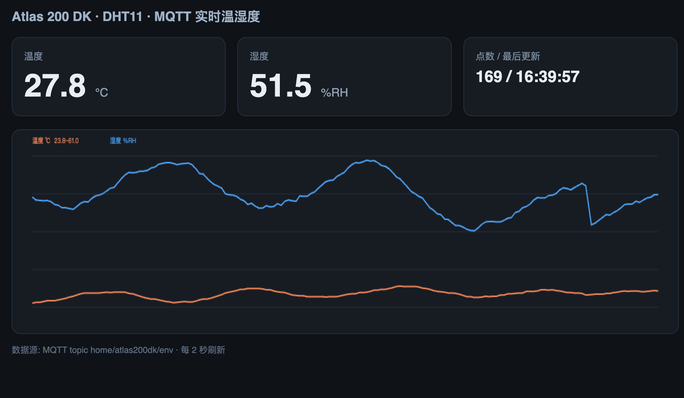

# 基于 Atlas 200 DK 的温湿度采集与 MQTT 云边传输

姓名：许盛凯　学号：2024141460445　日期：2026年11月11日

## 实验目的

本实验以环境温湿度监测为对象，使用 DHT11 传感器、Atlas 200 DK 开发板和局域网上位机构建数据采集、MQTT 传输及网页展示链路，理解终端感知、边缘处理与服务端接收之间的分工。

具体目标为：掌握 Atlas 40Pin 接口与 Linux GPIO 编号的对应关系；理解 DHT11 单总线通信与校验方法；分析用户态采样在微秒时序下的限制；掌握 MQTT 发布订阅、JSON 数据封装和接收端可视化，并结合记录间隔评估系统运行情况。

## 实验环境

| 项目 | 配置 |
| --- | --- |
| 边缘设备 | Atlas 200 DK A1，Ascend 310；主机名 davinci-AIRv1-505 |
| 传感器 | DHT11；模块采用3.3 V供电，实验记录为自带10 kΩ上拉 |
| 板端系统 | Ubuntu 18.04.4 LTS，aarch64，Linux 4.19.90+ |
| 板端软件 | Python 3.6.9，GCC 7.5.0，paho-mqtt 1.6.1 |
| 上位机 | macOS，Python 3.10；运行MQTT Broker、订阅程序及Web看板 |
| 网络与端口 | Atlas：192.168.1.189/24；上位机：192.168.1.157/24；MQTT：1883/TCP；Web：8080/TCP |

上位机在本实验中模拟云端服务端，业务通信发生在同一局域网。板端承担采集、校验和上报，服务端承担消息转发、记录保存及展示；本次结果不等同于已完成公有云部署或 IEF 节点纳管。

## 实验内容 算法 程序 步骤和方法

### 1 系统结构与硬件连接

系统数据流为：DHT11 → Atlas 200 DK → MQTT Broker → 订阅与存储程序 → Web 看板。C 程序 dht_read 负责时序采样与解码；Python 程序 dht_mqtt.py 负责调用采集器、组织 JSON 并发布消息。Broker、recv.py 和 web.py 运行在上位机，发布主题为 home/atlas200dk/env。

| DHT11端子 | Atlas 40Pin物理针脚 | 功能 |
| --- | --- | --- |
| VCC / + | 1号，3.3 V | 传感器供电 |
| GND / − | 6号，GND | 传感器与开发板共地 |
| DATA / S | 7号，GPIO0 | 单总线数据；官方镜像对应sysfs gpio504 |

物理针号7、板端信号名GPIO0和软件编号504属于不同编号体系。GPIO1对应gpio444；GPIO3至GPIO7经PCA6416进行I²C扩展，不选作本例的微秒时序采样引脚。模块按VCC、GND、DATA丝印识别，接线前关闭电源。

3.3 V供电不代表信号可接任意GPIO。40Pin硬件表与外围驱动指南对GPIO0电平的标注存在差异，接线须以具体板卡版本的外部接口电气要求为准；如板卡外部7号接口为1.8 V，应采用适合开漏单总线的双向电平转换，不将DATA上拉到5 V。

### 2 GPIO初始化与权限

访问前检查 /sys/class/gpio/gpio504 是否存在，未导出时由具备权限的用户导出。将方向设为输入后，带上拉且传感器空闲时通常读到1。读取value只能检查当前电平，不能直接得到温湿度。运行采集程序时需具备direction和value属性的读写权限；实验结束后释放由本程序占用的资源。

```
# 在Atlas上由有权限的用户执行的初始化示例
sudo sh -c '[ -d /sys/class/gpio/gpio504 ] || echo 504 > /sys/class/gpio/export'
sudo sh -c 'echo in > /sys/class/gpio/gpio504/direction'
cat /sys/class/gpio/gpio504/value
```

### 3 DHT11协议与读取流程

主机先拉低总线至少18 ms，再切换为输入或高阻状态，由上拉电阻恢复高电平。传感器随后以约80 μs低电平和80 μs高电平应答。每个数据位先保持约50 μs低电平，再以高电平宽度表示数值：约26～28 μs表示0，约70 μs表示1。

一帧40 bit共5字节，依次为湿度整数、湿度小数、温度整数、温度小数和校验字节。校验条件为：前四字节之和的低8位等于第五字节。程序需要结合应答结构、40位完整性和校验和识别有效帧，不能只凭一个较长高电平定位帧起点。

本例将起始低电平保持约20 ms；之后连续采样并记录电平跳变的时间戳，再根据高电平持续时间组装数据。本实验采用45 μs作为位判决阈值。失败帧应丢弃并记录错误，读取重试也需遵守传感器的最小采样间隔，不能连续快速触发。

### 4 C采样与Python上报的分工

DHT11的有效高脉冲较短，Python解释器、sysfs系统调用和Linux调度引入的延迟都可能影响边沿捕获。因此，将紧凑的采样循环放在C程序中，Python负责周期控制和网络通信。以下节选展示采样循环的作用，不构成可独立编译的完整程序。

```
/* 采样循环节选：对已打开的GPIO value文件采样 */
while (now_us() < deadline && n < MAXEV) {
    if (pread(fd, buf, 1, 0) != 1) continue;
    int v = (buf[0] == '1');
    long long t = now_us();
    if (v != prev) {
        ts[n] = t; lv[n] = v; n++; prev = v;
    }
}
/* 识别完整帧后，按高电平宽度判位并校验5字节 */
```

C实现减少了解释器开销，但sysfs访问仍需进入内核，用户态忙等也不提供实时性保证。是否丢失边沿需要以实际捕获记录判断，不能仅根据语言选择或一次读取成功确定。对可靠性要求更高时，应评估匹配板端内核的GPIO事件接口或DHT11 IIO驱动。

### 5 MQTT传输与服务端展示

板端使用paho-mqtt连接上位机192.168.1.157的1883端口，keepalive设为30 s，采用QoS 0，目标采集与发布周期约2 s。连接异常时按3 s间隔尝试重连；采集异常与网络异常分别记录，失败数据不以固定温湿度代替。一次采集任务最多尝试4次，相邻触发间隔至少2 s；发生重试时，发布间隔会相应延长。

消息字段包括device、sensor、temperature、humidity、gpio和ts，分别表示设备、传感器、温度、相对湿度、GPIO编号与采样时间。JSON封装后发布到home/atlas200dk/env主题。采样时间与接收时间属于不同时间基准，未同步时不直接用于精确端到端时延计算。

实验记录采用Python实现的简易Broker进行消息转发，并处理连接、发布、订阅和心跳等基本操作。订阅程序解析消息后追加保存为CSV；Web服务通过/api/history提供最近记录，看板按约2 s间隔刷新，展示当前读数和历史曲线。这一实现用于验证实验所需功能，不代表覆盖MQTT规范的全部行为。

## 数据记录 和计算

### 1 连续读数与时序现象

实验记录中的一组连续读数如下。各条温湿度相同，说明该时间窗口内读数未出现可见变化；相同值本身不能证明重复发送，也不能证明测量精度。

| 序号 | 板端时间 | 温度 / ℃ | 湿度 / %RH | 校验 |
| --- | --- | --- | --- | --- |
| 1 | 18:12:28 | 27 | 27 | 通过 |
| 2 | 18:12:30 | 27 | 27 | 通过 |
| 3 | 18:12:32 | 27 | 27 | 通过 |
| 4 | 18:12:34 | 27 | 27 | 通过 |
| 5 | 18:12:36 | 27 | 27 | 通过 |

调试记录给出的数据0高段约23～25 μs、数据1高段约70～72 μs，位间低段约52～54 μs，与45 μs判决阈值具有分离空间。记录中的“应答低52 μs”短于协议典型值，可能包含捕获窗口截断或分段误差，不将其解释为完整应答时长。

调试记录还记载Python实现两次未成功解码，C实现四次解码通过。该对照仅反映少量尝试下的现象，不足以统计长期成功率，也不能据此计算语言实现的性能提升倍数。

### 2 接收记录统计

长时间运行的记录汇总如下。统计对象是接收端保存的数据，采集失败帧与未送达消息不在该数据集合内。

| 指标 | 记录结果 | 指标 | 记录结果 |
| --- | --- | --- | --- |
| 接收记录条数 | 11758 | 时间跨度 | 约9.64 h |
| 间隔中位数 | 2.0 s | 间隔大于5 s | 22次 |
| 最长相邻间隔 | 1584 s | 最长间隔折算 | 26.4 min |
| 温度范围 | 26～28 ℃ | 温度均值 | 27.37 ℃ |
| 湿度范围 | 22～57 %RH | 湿度均值 | 23.85 %RH |

若9.64 h表示首末记录的时间跨度，11758条记录共有11757个相邻间隔，平均间隔约为9.64×3600÷11757＝2.95 s。若全部按2 s等间隔记录，相应时间跨度仅约6.53 h。因此，中位数2 s只能说明典型记录间隔，不能据此认定全程连续、无中断运行。

22次超过5 s的间隔和最长26.4 min的缺口表明采集或传输流程存在中断。原因可能涉及采集重试、进程重启、网络断开或接收端暂停，需要关联各端日志判断，不能仅凭间隔将其全部归因于人为重启。

### 3 Web展示与结果边界



图1  上位机温湿度Web看板截图

截图显示主题home/atlas200dk/env、约2 s刷新设置，以及温度27.8 ℃、湿度51.5 %RH、点数169和最后更新时间16:39:57。该图用于说明页面布局与展示内容，不能与上表18:12时段或11758条长时记录直接视为同一观测窗口。

页面显示小数位不等于传感器具有相同分辨率；还需结合原始字节、解码规则及是否进行了插值或平滑确认。图像本身不能验证原始数据来源、采集成功率或MQTT丢包率。

QoS 0为至多一次传递，不提供接收确认。接收端累计保存11758条消息，可以说明收集到的记录规模；缺少发送端序号及发送接收对账时，不能得出“零丢包”。同样，输出记录均通过校验，不等于所有采集尝试均成功，因为失败帧可能已被板端丢弃。

## 结论 结果

本实验围绕DHT11、Atlas 200 DK与局域网上位机构建温湿度采集、MQTT上报、CSV记录和Web展示流程。C负责时序相关处理，Python负责消息封装与传输，体现了端侧感知、边缘处理和服务端展示的分工。

实验记录汇总为11758条接收数据，时间跨度约9.64 h，记录间隔中位数2.0 s，同时存在22次大于5 s的间隔。结果说明链路能够积累并展示温湿度数据，但不足以证明全程连续采样、零丢包或所有采集尝试均校验成功。

本次在同一局域网模拟云端业务，未据此认定完成IEF纳管。后续评价可靠性时，应分别统计总采集次数、校验失败数、重试次数、发送条数及接收条数，并以运行标识和消息序号进行关联。

## 小结

本实验使我进一步理解了硬件协议与软件执行方式之间的关系。对于微秒级单总线通信，代码逻辑正确并不意味着时序一定满足要求，需要同时考虑GPIO访问路径、采样窗口和操作系统调度。将采样与网络通信分开，有助于分别定位传感器读取失败和消息传输异常。

在结果分析中，记录间隔的中位数与平均值反映不同特征；有效记录数也不能替代采集尝试数和端到端投递统计。后续可优先补齐原始日志和消息序号，增加断线缓存与进程托管，再评估内核采样驱动、MQTT鉴权和TLS等改进。

### 参考资料

[1] 智能边缘计算第八周云边协同实验课件。
[2] 华为 Atlas 200 DK 外围设备驱动接口操作指南，第2章。
[3] 奥松 DHT11 产品手册。
[4] OASIS MQTT Version 3.1.1，第4.3.1节。
